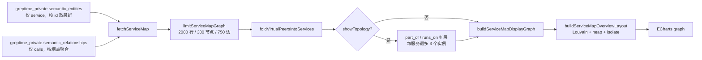
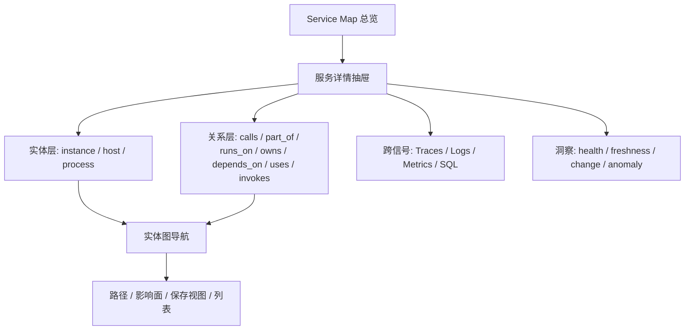

# Service Map 产品复盘：现状、对标与演进建议

> 代码基线：`feat/livedashboard`（2026-10-29 起；下文「落地结论」相对当时 review 基线 `e45cf4d1`）
> Review 范围：Drilldown 内的 Service Map（`?view=service-map`）。不含后端 Semantic Graph 的推导正确性、压测与视觉设计规范。
> 对标：GreptimeDB Semantic Graph、Datadog Service Map、Grafana Cloud Entity Graph。
> 说明：外部产品能力以 2026-10 官方文档为准；§1–§8 为静态分析原文，**§0 以落地后结论为准**。

---

## 0. 结论摘要（含 2026-10-29 落地）

### 0.1 一句话判断

Service Map 仍是 **trace 派生服务调用图（call graph）**，不是通用 entity graph。本轮在**可信度与若干做深点**上补了一刀；**暂无紧急排期**——剩余差距多为差异化 / 体验增强，等有声明边数据或明确客户需求再开。

### 0.2 本轮已落地（真正保留的改动）

| 项 | 做了什么 | 刻意不做 / 已回退 |
| --- | --- | --- |
| **Scope 多值** | entities SQL `PARTITION BY entity_type, entity_id, scope`；节点 `scopes[]`；环境筛选按全量 scope | 不在前端用 scope 伪造 env 隔离 |
| **Health v0** | 最小样本 20；`critical` / `warning` / `ok` / `low-traffic` / `no-data`；环与边同口径 | 不做 p95、baseline、双层环、SLO |
| **Calls provenance** | calls SQL 保留 `provenance`；tooltip 可显示来源 | **不查** `depends_on` / `owns`；**无 Layer 切换**（无声明数据时 Dependencies 只会平铺孤立点） |
| **Context menu** | 保留原菜单；新增 **View Metrics**、**Open in SQL** | — |
| **服务过滤下推** | 已选服务 → SQL `IN` + refetch，减轻 LIMIT 后再筛丢长尾 | scope / facet 仍客户端过滤 |
| **Topology 二次 limit** | 结构扩展后按节点上限再截断 | — |

**试过后拿掉的（避免重复 / 无数据价值）：**

- Catalog badge / 作用域说明文案（用户认为无必要）
- Traffic / Dependencies / All 图层与声明边查询
- 服务详情侧栏（Identity / 健康 / 邻居 / 侧栏出口）；inspect 仍只做一跳邻居图 + 顶栏 Active/Back
- 侧栏内与 tooltip、菜单重复的健康解释、邻居列表、跳转按钮

### 0.3 当前状态 vs 原 P0/P1 清单

| 原编号 | 原问题 | 现状 |
| --- | --- | --- |
| P0-1 scope 单值丢数据 | 多环境丢行 / 筛错 | **已修** |
| P0-2 健康过简 | 低流量误判红 | **已修（v0）** |
| P0-4 Catalog 不透明 | 切库误导 | **不做 UI 标识**（模型仍是 catalog 级；假过滤 database 仍禁止） |
| P1-C provenance / declared | 声明边不可见 | **calls 带来源即可**；声明图层等有数据再做 |
| 过滤 LIMIT 丢长尾 | 筛不到 | **已选服务下推已修** |
| topology 突破上限 | guardrail 失效 | **已修** |
| 跨信号出口 | 仅 traces / logs | **菜单已加 Metrics + Open in SQL** |
| 服务详情层 | 无属性抽屉 | **明确不做**（hover + inspect + 菜单够用） |

### 0.4 后续策略（无紧急）

**当前结论：先停在这里，没有必须立刻跟进的项。**

仍可保留的方向性判断（非排期）：

- 不要另起通用 entity graph 页；需要时以服务为中心做宽。
- 声明依赖 / Agent Graph / 路径影响面 / List view：有数据或客户场景再开。
- Catalog 真按库拆边：后端加字段或自推 calls，独立项目，不要前端假过滤。

### 0.5 成熟度评分（落地后，1–5，主观）

| 维度 | 分数 | 判断 |
| --- | --- | --- |
| 数据模型 | 3 | 仍以 service / calls 为主；provenance 已进 calls |
| 图渲染 | 4.5 | 布局 / 编码 / hover 成熟；topology limit 已守住 |
| 交互 | 3.5 | hover / inspect / 菜单（含 Metrics、SQL）完整 |
| 可信度 | 3.5 | scope + health v0 已补；声明边未产品化 |
| 跨信号 | 3.5 | traces / logs / metrics / SQL 均可从菜单出口 |
| 规模化 | 3.5 | 服务下推 + topology 二次 limit |
| 可访问性 | 1.5 | 仍仅图，无列表 / 键盘 |
| 差异化 | 2 | 声明边 / 多实体 / agent 仍未用 |

> 读法：本轮优先补了可信度与出口；**不继续为对齐 Datadog/Grafana 而堆功能**。

### 0.6 这份文档应该怎么用

| 层次 | 可信度 | 用法 |
| --- | --- | --- |
| §0 落地结论 | 高 | **当前产品事实与停更边界** |
| §1–§4 现状 / 对标 | 中–高（部分条目已过时） | 作背景；以 §0.2 / §0.3 为准 |
| §5 差距方案 | 设计参考 | 未落地项不是承诺；无紧急跟进 |
| §6 路线图 | 低 | 方向性；**当前不排 Phase 0 整包** |

- **P0 也不等于"全做"**：P0-4（半天级）、P0-1（小改）、health v0 是"现在做"；P1-C 条件升 P0。
- 对标 Datadog / Grafana 的差距，很多是对方整套 APM / Knowledge Graph 的产物；除非 Greptime 用户主路径证明需要，否则不补。
- 文中的百分比是修辞，不是度量；排期前先验证。

---

## 1. 当前实现盘点

### 1.1 入口与上下文

| 维度 | 现状 | 证据 |
| --- | --- | --- |
| 入口 | Drilldown → Traces → tabs `Overview / Service Map` | [`index.vue`](../../src/views/dashboard/drilldown/index.vue#L158-L180) |
| URL | `?view=service-map&signal=traces`，URL 同步强制 `signal=traces` | [`use-drilldown-url-sync.ts`](../../src/observability/use-drilldown-url-sync.ts#L150-L153) |
| 时间窗 | 共享顶栏 TimeRange，默认 30 min；`time` / `rangeTime` / `refreshKey` 变化触发重查 | [`context.ts`](../../src/observability/context.ts#L160)、[`service-map/index.vue`](../../src/views/dashboard/drilldown/service-map/index.vue#L260-L270) |
| 筛选 | 进入 Service Map 后顶栏 filter bar 隐藏，改用图内 env/scope + facets + 服务搜索 | [`top-bar.vue`](../../src/views/dashboard/drilldown/components/top-bar.vue#L14) |
| 数据源库 | 仅用 `ctx.connection.databaseFor('traces')` 作为 SQL 执行库；查询本身不带 schema 谓词 | [`fetch.ts`](../../src/observability/adapters/service-map/fetch.ts#L379-L398) |
| 刷新 | 手动刷新 + 时间变化；无自动轮询 | 同上 |

> 结论：Service Map 在信息架构上被定位为 "Traces 的一个视图"，而不是独立的一等 signal。这带来一个好处（时间 / 信号上下文天然共享），也带来一个限制（无法拥有独立的筛选 / 刷新 / 布局偏好）。

### 1.2 数据链路



关键查询（[`service-map-queries.ts`](../../src/observability/traces/service-map-queries.ts)）：

- **实体**：[`buildServiceMapEntitiesSql`](../../src/observability/traces/service-map-queries.ts#L47-L62)
  - `entity_type = 'service'`；
  - `ROW_NUMBER() OVER (PARTITION BY entity_type, entity_id ORDER BY observed_at DESC)` 取 `rn = 1`；
  - 只按 `observed_at` 过滤，不按 schema / database；
  - `ORDER BY entity_id LIMIT 2000`。
- **调用边**：[`buildServiceMapCallsSql`](../../src/observability/traces/service-map-queries.ts#L68-L83)
  - `rel_type = 'calls'`；
  - `confidence >= 1` 才计入 request / error / duration，`unmatched_count` 全量累加；
  - `GROUP BY src_type, src_id, dst_type, dst_id`；
  - `ORDER BY request_count DESC LIMIT 2000`。
- **结构边**：[`buildServiceMapStructuralSql`](../../src/observability/traces/service-map-queries.ts#L94-L129)
  - 只请求 `part_of` / `runs_on`；`contains` 在常量里但从未被查询。
- **实例数**：[`buildServiceMapInstanceCountsSql`](../../src/observability/traces/service-map-queries.ts#L132-L144)
  - `part_of` + `confidence = 1.0`，按 service 聚合 `COUNT(DISTINCT src_id)`。

硬上限（[`service-map-queries.ts`](../../src/observability/traces/service-map-queries.ts#L6-L15)）：

| 限制 | 值 | 说明 |
| --- | --- | --- |
| SQL 实体行 | 2000 | 按 `entity_id` 排序截断，不是按流量 / 重要度 |
| SQL 关系行 | 2000 | 按 `request_count` 排序截断 |
| 显示节点 | 300 | 按边流量贪心纳入，剩余节点补位 |
| 显示边 | 750 | 同上 |
| 每服务实例卫星 | 3 | 按 `source` 字母序取前 3，不是按流量 / 健康 |

### 1.3 节点与边模型

**节点**

| 类型 | 来源 | 视觉 | 备注 |
| --- | --- | --- | --- |
| `service`（真实） | `semantic_entities` | 圆形 SVG，内嵌 req/s + error%，外环成功 / 错误占比 | 节点大小随流量 log 缩放（48–76px） |
| 虚拟对端 | calls 边端点，实体表中不存在 | `roundRect` 虚线；database / virtual_node 两色 | 可由 `connection_type` 区分数据库 / 外部依赖 |
| `service.instance` / `k8s.pod` | `part_of` 边 | 菱形、小尺寸 | 仅 `showTopology` 开启时出现 |
| `container` / `k8s.container` / `host` / `process` | `runs_on` 边 | 小圆角矩形、虚线 | 仅随实例展开 |
| 集群节点 | 过滤后"被隐藏的中间服务" | `roundRect`，标签 "N hidden services" | 点击展开；用于保持两端服务的连通关系 |

> **结构卫星 ≠ 实体图。** 开启 `Instances & containers` 后，确实会出现 `service.instance` / `k8s.pod` / `container` / `host` 等非 call 节点，但它们只是 call 图上的"结构卫星"：只覆盖 `part_of` / `runs_on`，每个服务最多 3 个实例，只对已出现在 call 图中的服务生效；没有实体属性 / 详情 / 搜索 / 独立健康，也不含 `contains` / `owns` / `depends_on` / `uses` / `invokes`。把它理解为"拓扑叠加层"，而不是"实体层"。

**边**

| 关系 | 视觉 | 指标 |
| --- | --- | --- |
| `calls` | 实线，宽度随流量 log 增长，箭头表方向 | request / error / error rate / avg duration / max duration / unmatched |
| `part_of` / `runs_on` | 细虚线、低饱和 | 无 RED，tooltip 只显示关系名 |
| 仅 unmatched 的 calls | 虚线、0.5 透明度 | 表示"有客户端 span、无配对 server span" |
| 集群重映射后的 calls | 端点折叠后重新聚合 | RED 求和；自环被丢弃 |

### 1.4 视觉编码

| 编码 | 含义 | 备注 |
| --- | --- | --- |
| 节点直径 | `log1p(traffic)` 映射；真实服务 48–76px，虚拟 14–36px，集群 44px | 流量 = request + unmatched（双向合计） |
| 节点内主文字 | 入站请求速率；无入站时用出站 | `nodeDisplayCallStats` |
| 节点内次文字 | 双向中较差的错误占比 | 不是错误率阈值，是比例 |
| 节点外环 | 成功 / 错误占比弧 | 图例写作 "Ring / 成功占比 / 错误占比" |
| 边宽 | `log2(traffic+1)`；同社区更粗 | 结构边固定细线 |
| 边色 | 错误率 ≥5% 红色；否则主题边色；结构边结构色 | 阈值见 [`metrics.ts`](../../src/observability/adapters/service-map/metrics.ts#L5) |
| 边虚线 | 结构边、仅 unmatched、hover 流 | 结构边与异常边共用虚线，语义略混 |
| Hover | 非邻接节点降到 0.22 透明度，非邻接边降到 0.12；虚线边播放流动动画 | 仅鼠标；键盘不可触发 |

服务节点的 SVG glyph 在 [`chart-option.ts`](../../src/views/dashboard/drilldown/service-map/chart-option.ts#L105-L130) 中生成，健康 / 尺寸映射在 [`metrics.ts`](../../src/observability/adapters/service-map/metrics.ts#L199-L250)。

### 1.5 布局

[`layout.ts`](../../src/observability/adapters/service-map/layout.ts) 是当前体验的核心，也是与 Datadog 差异最大的地方：

1. **Louvain 社区发现**（按 `log1p(traffic)` 加权），把调用紧密的服务聚成 heap；
2. **≤2 个成员的社区吸收到最强邻居**，减少孤立小堆；
3. **按平均调用深度排序**，从左到右、从上到下打包，每行最多 4 个 heap；
4. **heap 内 hub + satellites 环形排布**，hub 是度数最高的服务；
5. **孤立服务**单独排在主图下方一行；
6. **虚拟节点**锚定在最强调用方右下方，避免遮住父节点标题；
7. **结构卫星**（instance / container）挂在服务外侧，按"远离质心"的方向扇形展开；
8. **不做严格 DAG 分层**：左右顺序只是"平均深度"的弱约束，不保证上游在左、下游在右。

> 产品含义：布局优先"读得出社区 / 聚类"，而不是"读得出调用方向"。对 RCA 来说，Datadog 的"左客户、右根因"是更强的方向语义；当前需要靠箭头和 hover 才能判断上下游。

### 1.6 交互

| 交互 | 行为 | 评价 |
| --- | --- | --- |
| Hover 节点 | 高亮流、dim 其余、tooltip（入 / 出站 RED、实例数） | 信息密度好；无键盘等价 |
| 左键节点 | 打开上下文菜单：查看详情 / View Traces / View Logs | 菜单位置自动避让边缘 |
| 点击集群 | 展开 / 收起隐藏服务 | 无成员预览 |
| 查看详情（inspect） | 只保留该节点 + 一跳邻居 + 该服务的结构卫星；顶部显示 Active node / Back | 等价 Datadog inspect，但没有左 / 右方向语义 |
| 点击空白 | 关闭菜单，但保持 inspect | 符合预期 |
| Escape | 先关菜单，再退 inspect | 细节到位 |
| 边 hover | tooltip 显示 RED；边不可点击 | 无"按边过滤 / 下钻" |
| 缩放 | 按钮 + 滚轮 / 拖拽；reset 清 center | 有自然缩放补偿，避免 inspect 时被 bbox 放大 |
| 过滤 | env / scope、facets、服务多选 | 无排除、无计数、无 "Only" 快捷 |
| 服务跳转 | 覆盖 `service` filter，跳 Traces 或 Logs detail | 不跳 Metrics；Logs 需已绑定表 |
| 拓扑开关 | 显示 / 隐藏 instance / container | 不持久化到 URL；无"全部展开 / 收起" |

### 1.7 过滤与 URL 状态

- 三层过滤：
  1. **Environment / scope**：`node.scope` + `env` / `deployment.environment` 等属性，去重后作为专用下拉；
  2. **Facets**：服务实体的 `descriptive` / `entity_id_attrs` 展开成 key-value，只有 ≥2 个不同值才出现；
  3. **服务搜索**：真实 service 的 label 多选。
- 语义：同 key 多值 OR，不同 key AND，服务选择与 scope 也是 OR；`selectedServices` 同时匹配 `label` / `id` / `serviceValue`。
- 失效值自动收敛：facets / options 变化后，不在候选集里的已选值会被删除并回写 URL（[`index.vue`](../../src/views/dashboard/drilldown/service-map/index.vue#L425-L455)）。
- URL 只存 `serviceMapSearch` / `serviceMapScope` / `serviceMapFilters`，用 `router.replace` 写入；hydrate 只做一次，避免 route→state 循环。
- **未持久化**：inspect 节点、拓扑开关、缩放、cluster 展开状态。刷新后回到总览。
- **无浏览器历史**：过滤 / Inspect 用 replace，Back 不会逐步回退图状态，只能靠 Escape / Back 按钮。

### 1.8 异常、降级与边界

| 场景 | 行为 | 风险 |
| --- | --- | --- |
| 缺少 semantic 表 | 识别 `Table not found` + `semantic_entities` / `semantic_relationships`，显示"当前 GreptimeDB 不支持 Service Map" | 只探测表存在，不探测列 / 关系类型；nightly schema 变更可能静默失败 |
| 其他 SQL 错误 | 展示服务端错误文本 | 无重试按钮；需改时间 / 刷新触发 |
| 行数 / 节点 / 边截断 | warning alert | 不告诉用户"被截断的是哪些服务 / 边" |
| 部分表无权限 | GreptimeDB 按表鉴权，结果静默变少 | UI 无"部分可见"提示，用户可能误判拓扑 |
| 实例数查询失败 | 静默吞掉，详情仍可用 | 可接受 |
| 请求竞态 | `requestId` 守卫，只接受最新响应 | 没有 AbortController，旧查询仍占资源 |
| 空图 | 区分"无数据"与"无匹配" | 没有引导用户去配置语义 / 时间窗 |
| 实验特性 | 无版本提示 | Semantic Graph 在 GreptimeDB 文档中仍标记 experimental |

### 1.9 工程质量与本地化

- 代码约 4.9k 行（含测试），拆分为 `types / fetch / graph / layout / metrics / chart-option / chart-theme / url-state`，边界清楚；但 [`index.vue`](../../src/views/dashboard/drilldown/service-map/index.vue) 仍有 976 行，承载查询、菜单、缩放、图例、URL、tooltip 上下文，后续加详情面板前建议拆分。
- 单测覆盖 queries / fetch / graph / layout / metrics / chart-option / url-state；**没有 Service Map 的 e2e**（`tests/` 只有 release smoke）。
- i18n：en-US / zh-CN 各 48 个 key；**ja-JP 只有 title 1 个 key**，其余回退英文（`fallbackLocale: 'en-US'`）。`scope` 标签、facet label 仍是英文 / 原始属性名。
- 可访问性：图为 ECharts SVG，无 tabindex / 键盘节点导航 / 列表替代；健康与流量主要靠颜色和大小；`prefers-reduced-motion` 已处理；tooltip 有 HTML 转义。

### 1.10 功能清单（一页版）

| 能力 | 状态 | 备注 |
| --- | --- | --- |
| 服务调用图 | ✅ | 自动从 Semantic Graph 生成 |
| 数据库 / 外部虚拟节点 | ✅ | 支持 database / virtual_node |
| 实例 / 容器拓扑 | ◐ | 结构卫星，不是实体层；默认关闭，每服务最多 3 个实例 |
| 服务搜索 | ✅ | 多选 |
| 环境筛选 | ◐ | 仅筛选，身份未隔离 |
| 属性 facets | ◐ | 通用 key，缺 type / deploy / monitor / incident |
| 中间节点折叠 | ✅ | cluster 可展开 |
| Hover 流量 | ✅ | 虚线流动 + dim |
| 一跳 inspect | ✅ | 无上下游方向语义 |
| 服务详情 | ❌ | 只有 tooltip |
| 健康状态 | ❌ | 仅错误占比环 |
| 延迟百分位 | ❌ | 只有 avg / max |
| 指标下钻 | ❌ | 只有 traces / logs |
| 路径 / 影响面 | ❌ | 无多跳 |
| 时间对比 / 演化 | ❌ | 无 |
| 列表视图 | ❌ | 无 |
| 保存视图 | ❌ | 只有 URL |
| 导出 / 分享 | ◐ | URL 可分享，无图片 / JSON |
| 键盘 / 读屏 | ❌ | 图不可键盘导航 |
| 多语言 | ◐ | en / zh 完整，ja 缺 |
| 大图 guardrail | ◐ | 有上限，topology 可突破 |
| 不支持降级 | ✅ | 表缺失提示 |
| URL 状态 | ✅ | 服务 / 环境 / facets |
| 暗色 / 动效降级 | ✅ | `prefers-reduced-motion` |

### 1.11 核心用户任务覆盖

| 任务 | 用户问题 | 当前支持 | 主要缺口 |
| --- | --- | --- | --- |
| 发现 | 哪些服务不健康？ | ◐ 错误占比环，可肉眼扫 | 无健康排序 / 摘要 / 告警 |
| 定位 | 是哪一个上游 / 下游？ | ◐ inspect 一跳 + tooltip | 无方向布局、无 p99、无 baseline |
| 影响面 | 这个服务挂了，影响谁？ | ❌ | 无多跳 / 路径 / 影响面 |
| 验证 | 修好了吗？和上个窗口比？ | ❌ | 无时间对比 / 变更标记 |
| 行动 | 去看 trace / log / metric | ◐ traces / logs | 无 metrics / SQL / owner |

> 结论：当前产品覆盖"看拓扑"和"初步定位"，但"发现 → 定位 → 影响面 → 验证 → 行动"的闭环只完成了前两步。这比"图好不好看"更值得优先投入。

---

## 2. 对照 GreptimeDB Semantic Graph

### 2.1 GreptimeDB 提供了什么

根据官方文档（[Semantic graph](https://docs.greptime.com/nightly/user-guide/semantic-layer/semantic-graph/)）：

- 两张只读、查询时计算的表：`greptime_private.semantic_entities` / `semantic_relationships`；
- 60 秒窗口、`observed_at` 时间索引、`fresh_until` 新鲜度；
- 实体类型不限于 service：`host`、`k8s.pod`、`service.instance`、`process`、`container`、`gen_ai.agent` 等；
- 关系词汇：`calls`、`runs_on`、`contains`、`part_of`、`uses`、`invokes`、`depends_on`、`owns`；
- `provenance`（trace / attribute / declared / agent）、`confidence`、`attributes`；
- 支持**手工声明边**（`depends_on` / `owns` / 自定义 rel_type），且 provenance 是边身份的一部分；
- 虚拟节点：无配对 server span 的客户端 span，按 `service.peer.name` / `peer.service` / `db.namespace` / `db.name` / `server.address` 识别，`confidence = 0.5`，`connection_type = database | virtual_node`；
- `unmatched_count` 区分"对端没响应"与"流量没来"；
- 多跳用 `WITH RECURSIVE`，无 `GRAPH_TABLE / MATCH`；
- 权限按源表鉴权，查询不会扩大权限；
- 文档明确：`calls` 的推导等价于 Tempo service graph processor / OTel Collector `service_graph` connector 的 SQL 形态。

### 2.2 能力矩阵

| 能力 | GreptimeDB | 当前 UI | 判断 |
| --- | --- | --- | --- |
| 实体类型 | 任意声明类型 | 仅 service + 结构端点 | ❌ 差一个数量级 |
| 关系类型 | 8 种内置 + 自定义 | calls / part_of / runs_on | ❌ `uses` / `invokes` / `owns` / `depends_on` / `contains` 未用 |
| provenance | trace / attribute / declared / agent | 未读取、未展示 | ❌ 无法区分推导 vs 声明 |
| confidence | 1.0 / 0.5 / 自定义 | 仅作 RED 过滤门槛 | ◐ 有使用，无可视化 |
| 声明边 | 支持，且与推导边共存 | 不支持（只查 calls） | ❌ 手工拓扑不可见 |
| scope | 独立列，**不是 identity** | 仅单值筛选，其他 scope 会丢 | ❌ 未按语义使用；边无法按 scope 拆 |
| fresh_until | 有 | 未使用 | ❌ 无法表达"已消失 / 过期" |
| descriptive | JSON 快照 | 仅用于 facets | ◐ 未展示完整属性 |
| entity_id_attrs | JSON | 用于 label / serviceValue | ◐ 未展示多列身份 |
| source_tables | JSON 数组 | 解析后未展示 | ❌ 无法跳到源表 / 信号 |
| 虚拟节点 | 支持 | 支持 | ✅ 做得不错 |
| unmatched | 支持 | tooltip 展示 | ✅ |
| 多跳 / 路径 | WITH RECURSIVE | 无 | ❌ |
| 权限 | 按表鉴权 | 静默部分结果 | ◐ 无提示 |
| 时间窗 | observed_at 规则 + 60s 对齐 | 共享 TimeRange | ✅ |
| 采样口径 | 文档明确 caveat | 无提示 | ❌ 用户可能把 RED 当真实流量 |
| 实验状态 | 文档标记 experimental | 仅表存在性探测 | ❌ 兼容性风险 |

### 2.3 三个具体错配

**（1）scope 被当成单值身份（P0）**

- GreptimeDB 文档明确：`scope` **不是 identity**，只是 filter / display column；如果环境需要区分两个实体，应该把 env 放进 `id` 声明（`greptime.semantic.entity.service.id = service_name,env`），而不是只设 `scope`。
- 当前实现却把 scope 当成节点的唯一环境：entities SQL 只按 `(entity_type, entity_id)` 分区取最新一行，节点 key 又是 `type + id`；于是同一服务在 prod / staging 的多行只活下来一行，其它 scope 值、descriptive、source_tables 都丢了。
- 即使多行都读到，`nodesFromEntities` 也会合并成一个节点，`scope` 用 `||=` 保留第一个、`groupAttributes` 用对象合并覆盖，env 值仍只剩一个。
- 更隐蔽的是：被 dedupe 掉的服务仍可能作为 calls 边端点出现，被 `ensureEndpoint` 建成 virtual 节点，再被同名折叠回真实服务——staging 的调用被算进 prod 节点。
- **边本身也没有 scope 列**（`semantic_relationships` 只有 src / dst id），所以 UI 无法把同一条边的 RED 按环境拆开；只有把 env 放进 entity id、让两端 id 不同，边才会自然分开。
- 影响：env 筛选不可信；多环境 scope / 属性丢失；边指标跨环境聚合。Datadog 的 env scoping 是产品级隔离，GreptimeDB 的等价物是 **id 级声明**，不是前端 key。
- 结论：不要在前端"把 scope 塞进 key"来伪造隔离；先把 scope 建模为多值属性，再给需要严格隔离的用户一条 id 声明路径。

**（2）provenance / declared edge 被合并（P0）**

- `buildServiceMapCallsSql` 只 `GROUP BY` 端点，不保留 `provenance`；文档说 provenance 是边身份的一部分，声明边与推导边应共存；
- 因此手工声明的 `calls`（例如"我知道这两个服务有依赖，但采样没覆盖"）会和 trace 推导的 `calls` 合并成一条边；
- 同时 `confidence >= 1` 的门槛会把 `confidence < 1` 的声明边 RED 全部置 0，只剩 unmatched 或空边；
- `depends_on` / `owns` 这类声明边则完全不在查询范围内，图上不可见；
- 影响：图看起来"有这条边"，但数字不可解释；用户无法区分"观测到的调用"和"人声明的依赖"。

**（3）读时推导成本 + 无缓存（P1）**

- 每次时间变化 / 刷新都重新扫两张表；Semantic Graph 是查询时计算，宽窗口成本随源表数据量增长；
- 当前没有按时间桶缓存、没有 Flow / 连续聚合、没有增量刷新；
- 影响：30 min 窗口通常没问题，但 24h / 7d 窗口、或大 trace 表会成为首屏瓶颈；这也限制了"时间演化 / 对比"类功能。

### 2.4 其他可借力的 GreptimeDB 特性

Service Map 不必把所有计算都放在前端。GreptimeDB 侧还有几项能力可以直接降低实现成本、增强差异化：

| 特性 | 可怎么用 | 对 Service Map 的价值 |
| --- | --- | --- |
| Flow（连续聚合） | 把 `calls` 的 RED 按 1m / 5m 预聚合到边表 | 降低 Semantic Graph 读时推导成本；长窗口 / 时间对比更稳 |
| Triggers（企业版） | 对 error rate / p95 / 流量骤降设规则，webhook 到事件表 | 服务端 health / incident，替代前端 5% 阈值 |
| TQL / PromQL | 节点 / 边详情页的 RED 趋势、p99 | 复用现有指标能力，补齐延迟维度 |
| SQL + `WITH RECURSIVE` | 路径、影响面、跨出当前显示图 | 比客户端 BFS 更强，且是 GreptimeDB 的原生能力 |
| Pipeline | 日志解析 / 分流、事件打标 | 详情页的日志 / 变更 overlay |
| `table_semantics` / 声明实体 | 统一 service / team / owner 身份 | 多实体、团队分组、声明边治理 |

> 注意：Flow / Triggers 会引入"预计算表"与"实时图"的一致性与延迟问题，需要明确 freshness 语义；不要为了性能牺牲"图是当前事实"的信任。

### 2.5 小结

当前 UI 把 GreptimeDB Semantic Graph 当成"service + calls 的只读 API"在用，只用到了它能力面的约 1/3。**最大的机会不是把图做得更像 Datadog，而是把 GreptimeDB 的实体 / 关系模型产品化**：多实体类型、声明边、来源 / 置信度、路径查询、AI agent 图，这些都是 Datadog / Grafana 不容易复制的能力。

---

## 3. 对照 Datadog Service Map

### 3.1 Datadog 的关键设计

根据 [Datadog Service Map 文档](https://docs.datadoghq.com/tracing/services/services_map/)：

- 节点 = APM / RUM 中的 service，边 = 聚合调用；节点只在所选时间窗内有数据时出现，30 天无数据自动老化；
- 节点边框颜色来自 **Service Health**：Watchdog 异常、paging monitors、incidents 的综合状态；
- 支持按 **team / application** 分组；
- Facets：service type、last deploy time、monitor status、incident status；支持 fuzzy search；
- 按 `env`（+ 可选第二 primary tag）**scoping**，不同 scope 是不同 map，scope 之间不能互相调用；
- Hover 高亮 + 动态流量线；点击 inspect 隔离服务，**左客户、右根因**；可逐节点 pivot；
- 过滤后两个服务之间若隔着未选中的服务，会折叠成 collapsed node；
- `service` tag 可 pivot 到 dashboards / logs / host map / monitors；monitor 状态直接暴露在图上；
- 前提：需要包含 root span 的完整 trace，span 丢失时 map 可能不可用。

### 3.2 能力矩阵

| 能力 | Datadog | 当前 | 判断 |
| --- | --- | --- | --- |
| 零配置接入 | APM / RUM 自动 | Semantic Graph 自动 | ✅ 持平 |
| 节点 / 边 | service / calls | service / calls | ✅ 基本持平 |
| 实时流量线 | hover 动画 | hover 虚线流动 | ✅ 视觉持平 |
| 健康语义 | Watchdog + monitors + incidents | 错误占比环 + 5% 边阈值 | ❌ 差一代 |
| 环境 scoping | 独立 map，跨 env 不连通 | filter，且身份未隔离 | ❌ 语义弱 |
| 按 team / app 分组 | 支持 | 无 | ❌ |
| Facets | type / deploy / monitor / incident | 通用属性 facets | ◐ 缺关键维度 |
| 模糊搜索 | 支持 | 多选搜索 | ✅ 接近 |
| 折叠中间节点 | 支持 | cluster 支持 | ✅ 接近 |
| Inspect / pivot | 左客户右根因，逐节点 | 一跳 ego，无方向语义 | ◐ 形似神不似 |
| 服务详情页 | 有 service page | 无 | ❌ |
| 跨信号 pivot | logs / dashboards / host map / monitors | traces / logs | ◐ 缺 metrics / monitors |
| RED | request / error / latency | rate / error / avg / max | ◐ 缺 p99 与趋势 |
| RUM | 支持 | 无 | ❌ |
| 节点老化 | 30 天 | 仅时间窗 | ❌ |
| 时间范围 | 支持 | 支持 | ✅ |
| 第二 primary tag | 支持 | 通用 facets 近似 | ◐ |
| 保存 / 分享视图 | URL / 分享（保存视图未在文档确认） | URL，无保存视图 | ◐ |
| root span 依赖 | 有，缺 root 可能不可用 | 不依赖 | ✅ 优势 |

### 3.3 小结

"看图"层面已经接近 Datadog：节点 / 边、hover、inspect、折叠、facets、时间窗都有。真正的差距在**"看完图之后做什么"**：

1. 没有 **service detail**：Datadog 点进去有 service page（health metrics、dependencies、deployments、error tracking、security insights 等），当前只有 tooltip + ego graph；
2. 没有 **health 语义**：Datadog 的红 / 黄边框是"有没有事"的结论，当前只是"错误占比"的原始比例；
3. 没有 **跨信号 pivot**：Datadog 可以从 service 直接跳到 logs / dashboards / host map / monitors，当前只能跳 traces / logs；
4. 没有 **团队 / 应用分组**：Datadog 的 group by team / application 是大规模微服务场景的刚需。

> 注意：以上是差异解释，不是补齐清单。除非用户数据证明主路径需要 service page / RUM / monitor 集成，否则不按 Datadog 全量对齐。

---

## 4. 对照 Grafana Entity Graph

### 4.1 关键设计

根据 [Grafana Entity graph 文档](https://grafana.com/docs/grafana-cloud/platform/knowledge-graph/troubleshoot-infra-apps/explore-entity-graph/)：

- 由 Knowledge Graph 基于 metrics 自动发现实体与关系，**每分钟更新**；数据源包括 Prometheus exporters、Istio、Beyla、OTel traces 派生 metrics、LogQL；
- 关系类型如 `HOSTS`、`CALLS`；拓扑随时间变化：Pod 从 Node-1 迁到 Node-2，窗口内会看到两个宿主；Pod 被删除会**置灰**；
- 实体有**双层环**：外环 = 自身 insight，内环 = 被包含实体传播上来的 insight；颜色 = INFO / WARNING / CRITICAL；
- 支持 **basic search**（`Show Service api-server` 这类自然语言式表达式）和 **advanced search**（实体类型、属性条件、insight 过滤、connected entity 关系），可保存视图；
- 点击实体 → 展示 connected entity 类型及数量 → 进入 Graph / List 视图，可 Back、可 "Only" 过滤；
- 每个实体有 **quick link** 到 connected entities 和 curated KPI dashboards；
- 提供 **List view**（可选列）、**RCA workbench**、按实体类型过滤图例；
- 按 `env` / `site` 过滤。

### 4.2 能力矩阵

| 能力 | Grafana Entity Graph | 当前 | 判断 |
| --- | --- | --- | --- |
| 图的数据基础 | Knowledge Graph（metrics 为主，多源） | Semantic Graph（traces；声明能力未全用） | ◐ 各有优势 |
| 实体类型 | Pod / Node / Service / ... | service + 结构端点 | ❌ |
| 关系类型 | HOSTS / CALLS / ... | calls / part_of / runs_on | ◐ |
| 更新频率 | 每分钟 | 按查询 / 刷新 | ◐ |
| 拓扑时间演化 | 迁移可见、删除置灰 | 无 | ❌ |
| Insight 环 | 双层 severity | 单层错误占比 | ❌ |
| Connected entities 导航 | 类型 + 数量 + Back / Only | ego graph + Back | ◐ 形似 |
| 搜索表达式 | basic + advanced + saved | facets + 多选 | ❌ 差一代 |
| KPI dashboards | 每实体类型 | 无 | ❌ |
| List view | 支持，可选列 | 无 | ❌ |
| RCA workbench | 支持 | 无 | ❌ |
| 图例按类型过滤 | 支持 | 仅 topology 开关 | ◐ |
| env / site 过滤 | 支持 | env / scope | ✅ 接近 |
| 团队 / 归属 | 可由实体属性 / 关系表达，无专门分组 | 无 | ◐ |
| 可访问性 | 图 + 列表双通道 | 仅图 | ❌ |

### 4.3 小结

Grafana 的 Entity Graph 本质是一个 **"知识图谱导航器 + insight 叠加层"**，而不是 APM service map。它的强项是：

- 实体类型多、关系多，能回答"这个 Pod 在哪台 Node 上、这个 Node 还影响谁"；
- 拓扑随时间变化可见（迁移 / 删除 / 置灰），适合变更与故障复盘；
- 搜索表达式 + 保存视图 + 列表视图，适合大团队反复使用；
- insight 双层环把"自身问题"与"被包含实体的问题"分开，这是 RCA 的关键语义。

当前的 Service Map 是一个 **"调用图查看器"**：社区布局、hover 流动、inspect 都很好，但缺少"实体 / 关系 / 洞察 / 搜索 / 列表"这些让图变成日常工具的部分。

> 注意：Grafana 的 Entity Graph 是另一条产品路线；是否走，取决于 §8 第 1 问（产品边界），而不是"差距数量"。

---

## 5. 差距与问题清单

> 说明：P0 = 影响可信度或会导致错误结论；P1 = 影响核心任务完成度；P2 = 体验 / 规模化 / 差异化。每条都给出代码 / 文档证据，便于直接开 issue。

### P0-1 把 scope 当成单值身份

- **优先级**：P0（低成本、潜在数据丢失）。如果生产数据里 0 个多 scope 服务，影响是潜在而非现实；仍建议修 SQL，但不必按"多环境事故"排期。
- **证据**：entities SQL 分区 `(entity_type, entity_id)` 取最新；节点 key `type + id`；`scope` 仅 `||=`；`groupAttributes` 覆盖合并。
- **根因**：GreptimeDB 的 `scope` 不是 identity；`semantic_relationships` 也没有 scope 列。UI 不能用前端 key 伪造环境隔离。
- **方案（两层）**：
  1. **UI 层：scope 多值化，不再丢数据**
     - SQL：`ROW_NUMBER() OVER (PARTITION BY entity_type, entity_id, scope ORDER BY observed_at DESC)`；每个 `(entity, scope)` 一行，客户端合并为 `scopes: string[]`。
     - 类型：`ServiceMapNode.scopes: string[]`（可保留 `scope` 做兼容）；env 类属性支持多值，不再用对象覆盖。
     - 展示：节点 badge `prod` / `prod +1`；tooltip 列出所有 scope；筛选"任一 scope 命中"；不再出现"选中 staging 节点消失"。
     - 边：保持一条；端点有多个 scope 时标 `mixedScope`，tooltip 提示"边指标跨环境合并；如需拆分，请把 env 加入 entity id"。
  2. **声明层：需要严格隔离时，env 进 id**
     - 文档 + 帮助提示：`greptime.semantic.entity.service.id = service_name,env`（所有声明该类型的表顺序一致）。
     - 这样 `entity_id` 变成 `api,prod` / `api,staging`，边端点不同，图自然分开；UI 无需特殊逻辑。
     - 可加"检测到同一服务多 scope"的提示，引导用户选择：合并展示 vs 改 id 拆分。
  3. **不要做的事**：不要把一条边复制到多个 scope；不要在前端按比例拆 RED；不要用 `scope` 当 key 造出"伪隔离"。
- **验收**：
  - 多 scope 行 → 1 节点 N 个 scope badge，筛选任一 scope 都能命中；
  - env 进 id → 2 节点、2 组边，RED 不混；
  - 混合 scope 边有明确提示，不双计；
  - 单测覆盖 scope 多行 / id 拆分 / SQL 行数不被重复行吃满。

### P0-2 健康语义过简

- **优先级**：v0（最小样本 + `low-traffic` / `no-data`）是 P0；5 状态细化、双环、p95、SLO / monitor 集成不是，按数据与需求再排。
- **证据**：节点环是错误占比；边红色阈值 5%；`healthFromNodeCallStats` 对服务节点被 SVG glyph 分支绕过；无最小请求数。
- **影响**：1 error / 2 requests 显示 50% 红环；低流量服务被误判；无延迟 / 饱和度 / 流量异常；用户无法比较不同流量服务的"健康"。
- **方案（详见 §5.4.1）**：
  - 5 状态：`critical` / `warning` / `ok` / `low-traffic` / `no-data`；窗口内请求数 <20 不下结论。
  - 自身健康（外环，入站优先）+ 依赖健康（内环，最差下游）；红环必须能解释"为什么红、从何时起、和谁比"。
  - Hover 解释 + Health 卡（错误 / 延迟 / 流量三行）+ `Only unhealthy` / 排序 / 摘要。
  - v0 只做 error + 最小样本 + no-data；v1 加 p95 / 流量 baseline；v2 接 SLO / monitor / Triggers。
  - 环 / 边 / 图例统一阈值；`low-traffic`、`no-data` 不得显示为绿色；声明边不得显示为"健康"。

### P0-4 作用域：catalog 级是唯一自洽模型，但必须显式

- **证据**：`semantic_entities` 有 scope，但没有 schema / database；`semantic_relationships` 连 scope / source_tables 都没有；查询只按 `observed_at` 过滤。
- **结论**：**不要做"当前 database"过滤**。只过滤节点会让边仍然跨库，形成"节点像 A 库、边是 A+B 库"的假象；要真正按库拆边，只能自己从 trace 表推导 calls，或让后端在 relationships 里加 scope / schema——都不是 UI 小改。
- **方案**：
  - 产品语义定为 **Catalog view**：工具条显示 `All databases` / `Catalog`；在 Service Map 视图隐藏或标注 database 选择器"不适用"。
  - 帮助说明："Semantic Graph 是 catalog 级；租户隔离请用独立 catalog / 实例。"
  - 不在 Service Map 提供 schema 过滤（会误导）；`source_tables` 只在详情面板展示，回答"这个实体来自哪些表"。
  - 如果客户必须按 database 隔离：给出两条路径——(a) 独立 catalog / 实例；(b) 立项"从 trace 表按库推导 calls"或推动后端 relationships 增加 scope / schema，作为独立项目，不混在 P0。
- **验收**：
  - 切 database 不再让人以为图会变（选择器隐藏 / 标注）；
  - 页面始终有 `Catalog` 标识；帮助有租户指引；
  - 不会出现"节点过滤了、边没过滤"的混合状态。

### P1-C provenance / declared edge（条件升 P0）

- **优先级**：默认 P1。生产数据里存在 `provenance = 'declared'` 或 `rel_type IN ('depends_on','owns')` 时，升 P0；没有声明数据时，这是差异化预留，不是当前信任事故。
- **先验证（约 1 小时）**：

  ```sql
  SELECT rel_type, provenance, count(*) AS rows
  FROM greptime_private.semantic_relationships
  WHERE observed_at >= now() - INTERVAL '30' MINUTE
  GROUP BY rel_type, provenance
  ORDER BY rows DESC;
  ```

  结果为 0 → 不急着做全量建模；有数据 → 按下面方案做。
- **证据**：calls SQL 不选 provenance，按端点聚合；`confidence >= 1` 过滤；`depends_on` / `owns` 不查询。
- **影响**：有声明边时，声明拓扑与观测拓扑混合；声明边可能没有 RED；用户无法判断边的可信来源。
- **方案（详见 §5.4.2）**：
  - SQL 保留 `provenance`，并把 `rel_type IN ('depends_on','owns')` 的声明边单独查询；边 key 加 `provenance`，同端点不同来源不合并。
  - 边模型加 `provenance` / `confidence` / `declared` / `hasTelemetry`；声明边显示 `No telemetry`，不显示 0% 错误。
  - UI 分 `Traffic` / `Dependencies` 两层；线型表来源、颜色表健康；tooltip 显示 Source / Confidence / Last seen / Valid until。
  - 过滤 `Observed only`（默认）/ `Include declared` / `Only declared`；同一对端点不求和；`owns` 驱动 owner 徽标与 team 分组。
  - 不要用 confidence 静默清零；至少在 tooltip 标注"低置信度 / 声明来源"。

### P1-1 实体与关系覆盖面太窄

- 只有 service + calls / part_of / runs_on；GreptimeDB 的 `uses` / `invokes` / `owns` / `depends_on` / `contains`、host / process / gen_ai.agent 都没进产品。
- **建议**：分两层——默认 service map；"实体层"按需展开 instance / host / process，并支持按关系类型过滤（calls / runs_on / owns / depends_on…）。AI agent 图可作为独立场景（见 P2-1）。

### P1-2 没有服务详情层

- 只有 tooltip + ego graph；无属性、无 source tables、无端点、无 RED 趋势、无负责人 / 部署、无 Metrics 入口。
- **建议**：右侧详情抽屉（不遮挡图），包含：
  - identity（id / scope / attrs / source_tables）；
  - RED 趋势（复用 drilldown 图表）；
  - 上下游列表（按流量 / 错误排序）；
  - 快捷 pivot：Traces / Logs / Metrics / SQL；
  - 后续：owners、deployments、SLO、incidents。

### P1-3 过滤在客户端 + SQL 先 LIMIT

- 先按 `request_count` 取 2000 条边，再在客户端筛服务；长尾服务可能被截断后再也筛不到。
- **建议**：
  - 把服务 / 环境 / facet 条件下推到 SQL（至少把已选服务映射为 entity id 后作为 `src_id / dst_id IN (...)` 谓词）；
  - 或先按筛选结果取子图，再对子图做 top-K；
  - 截断提示给出"被截断的边数 / 服务数"和"缩小时间窗"的建议。

### P1-4 topology 扩展突破节点上限

- `limitServiceMapGraph` 先限 300 节点，随后 `loadStructuralExpansion` 每服务追加 ≤3 实例 + 容器 / host，节点数可到数倍（至少 4x）；无二次限制。
- **建议**：
  - 扩展后重新 limit，或按服务懒加载（点开某服务再拉它的实例）；
  - 对卫星按流量 / 健康排序，而不是字母序；
  - 允许"只显示聚合实例数"而不展开。

### P1-5 缺少 Metrics 入口与 SQL 出口

- 当前只跳 traces / logs；Drilldown 已有 service 身份到 metrics 的映射能力。
- **建议**：上下文菜单加 "View metrics"；详情面板加 "Open in SQL"（把当前语义图查询带到 SQL Explorer），这既是 GreptimeDB 的差异化，也能让高级用户自定义多跳查询。

### P1-6 无路径 / 影响面分析

- 只有一跳 inspect；不能回答"从 A 到 B 怎么走"、"A 挂了影响谁"。
- **建议**：
  - 客户端 BFS（当前图 ≤300 节点足够快）做 shortest path / downstream impact；
  - 或走 GreptimeDB `WITH RECURSIVE`（深度上限 3–5），支持跨出当前显示图；
  - UI：选中两个服务 → "Path"；选中一个 → "Impact"。

### P1-7 无时间演化 / 新鲜度

- 未用 `fresh_until`；没有"新增 / 消失 / 迁移"状态；没有窗口对比。
- **建议**：节点加 last-seen / fresh 徽标；提供 "Compare to previous window"；后续做 topology diff（新增 / 删除 / 边变化）。

### P1-8 无 list view / 键盘 / 屏幕阅读器支持

- 图为 SVG，无 tabindex、无表格替代；颜色 / 大小是主要编码。
- **建议**：加 List view（服务、env、req/s、error%、p99、实例数、last seen），与图共享筛选；图节点支持键盘聚焦与 Enter 打开菜单；图例加文字 / 形状冗余编码。

### P1-9 i18n 与标签

- ja-JP 仅 1 个 key；`scope` 标签硬编码；facet label 是原始属性名机械转换。
- **建议**：补齐 ja 或显式只支持 en / zh；`scope` → "Environment"；facet 提供可读 label 映射（team / namespace / cluster…）。

### P2 体验与差异化

- **P2-1 AI agent 图**：`gen_ai.agent` + `uses` / `invokes` 是 GreptimeDB 独有场景，可做 "Agent Graph" 视图（agent → model / tool），与 service map 共享布局 / 详情组件。
- **P2-2 声明边作者化**：既然 GreptimeDB 支持 declared edges，可提供 "Declare dependency / ownership" 的轻量表单（或至少文档 + SQL 模板）。
- **P2-3 保存视图 / 分享**：命名视图、复制链接、PNG / SVG 导出、嵌入。
- **P2-4 聚类体验**：cluster 成员预览、按类型 / 团队展开、固定布局。
- **P2-5 虚拟节点折叠歧义**：当前按同名把虚拟对端折进真实服务；建议改为 opt-in 或标注 "folded inferred peer"，避免把外部依赖误认为内部服务。
- **P2-6 指标深度**：p99、sparkline、baseline 对比；当前只有 avg / max。
- **P2-7 视觉细节**：结构边与异常边都用虚线；图例 "Ring" 不够直白；低流量节点文字拥挤。
- **P2-8 维护性**：`index.vue` 拆分；补 e2e（进入、过滤、inspect、跳转、截断、不支持）。

### 5.4 三个关键设计的产品方案

#### 5.4.1 健康语义：从"错误占比"到"有证据的状态"

当前问题不是"颜色不够多"，而是**红色没有定义**：红色既可能是 1/2 个请求失败，也可能是 10 万请求里 6% 失败；用户无法回答"多红算红、样本够不够、延迟算不算、是我坏了还是下游拖累"。

**（1）状态模型**

建议用 5 个状态，而不是二元 red/green。下表是**默认值**，上线前需用真实数据校准：

| 状态 | 含义 | 默认触发条件 | 视觉 |
| --- | --- | --- | --- |
| `critical` | 明确影响用户 | error rate ≥5% 且窗口内 requests ≥20；或 p95 ≥2× baseline 且样本足够 | 红环 + `!` |
| `warning` | 有退化，尚未确认 | error rate 1–5%；或 p95 1.5–2× baseline；或流量较 baseline 下降 ≥50% | 黄环 + `!` |
| `ok` | 正常 | 样本足够且未触发 warning / critical | 绿环 |
| `low-traffic` | 样本不足，不下结论 | 窗口内 requests <20 | 灰环 + `~` |
| `no-data` | 无观测 / 无权限 / 过期 | 无入站行，或 `fresh_until` 已过期 | 空心虚线环 + `?` |

关键原则：

- **`low-traffic` 和 `no-data` 不能显示成绿色**，否则等于把"不知道"说成"健康"。
- 每个红色都必须能回答三个问题：**为什么红、从什么时候开始、和什么基准比**。
- 节点 / 边 / 图例使用同一套阈值；不要出现"节点环是比例、边是 5% 阈值"两套语义。
- p95 不能只靠 `semantic_relationships` 的 `duration_sum / duration_count / duration_max` 算出来；需要额外查询 trace 或 metrics。v0 可以先用 avg / max + error，p95 放到 v1。

**（2）v0 判定与数据来源**

v0 不引入新表，直接用现有 `calls` 边的 RED 计算：

```text
requests = inbound.requests > 0 ? inbound.requests : outbound.requests
errors   = inbound.requests > 0 ? inbound.errors   : outbound.errors

if requests < MIN_REQUESTS (默认 20)      -> low-traffic
else if errors / requests >= 0.05          -> critical
else if errors / requests >= 0.01          -> warning
else                                        -> ok
```

- 边用同一公式；`calls` 边 `requests = 0 && unmatched = 0` → `no-data`。
- 依赖健康 = 所有出边中 rank 最差的一条；同 rank 时取 error rate 更高 / 流量更大的一条。
- 没有入站的服务（叶子 / 客户端）用出站，并在 tooltip 标注 `client view`。
- `no-data` 还包括：窗口内该节点没有任何 `calls` 边、或 `fresh_until` 过期（需要 SQL 增选 `MAX(fresh_until)`）。

数据来源：

| 维度 | v0 数据 | 后续 |
| --- | --- | --- |
| requests / errors | calls 边 `request_count` / `error_count` | — |
| latency | avg（`duration_sum / duration_count`）、max | p95 需查 trace / metrics |
| traffic baseline | 无（v0 不做） | 前一窗口 / 昨日同时段 |
| freshness | `observed_at` / `fresh_until` | 节点级 last seen |
| SLO / monitor | 无 | v2 接入 |

> 注意：`duration_max` 是单次最大，不适合直接当 health 阈值；v0 只用 avg 做展示，不参与 critical 判定，避免长尾噪声。

**（3）自身健康 vs 依赖健康**

建议用**双层环**，而不是把所有问题混成一个颜色：

- **外环 = 自身健康**：入站（server-side）请求的错误率、延迟、流量；没有入站时用出站，并在 tooltip 标注"client view"。
- **内环 = 依赖健康**：该服务最差的一条下游 `calls` 边；没有下游时内环留空。
- 这样用户能区分"我自己坏了"和"下游把我拖红了"，避免 RCA 时把责任推给最吵的节点。
- 这与 Grafana 的"自身 insight / 被包含实体 insight"是同一类思路，只是把"包含"换成了"调用下游"。

**（4）视觉与交互**

- **环色 = 状态**；环内仍保留 `req/s` + `error%`；再增加一个小徽标表示非错误原因：`L`（latency）、`T`（traffic）、`~`（low traffic）、`?`（no data）。
- **不要只靠颜色**：状态同时用图标 / 文字 / 线型表达，保证色盲与截图场景可读。
- **Hover 解释"为什么"**，例如：

  ```text
  Critical · 错误率 8.2%（阈值 5%）
  1,240 requests / 30m · 102 errors
  p95 1.8s（baseline 0.4s）
  Top edge: checkout → payment 6.1%
  Since 14:02 · data through 14:10
  ```

- **点击打开 Health 卡**：错误 / 延迟 / 流量三行，每行显示当前值、阈值或 baseline、sparkline、贡献最大的边；提供 "View error traces" / "View slow traces"。
- **过滤与排序**：`Only unhealthy`、`Has no data`、按 severity 排序；图上方显示 `3 critical · 5 warning · 2 no data` 的摘要。
- **边健康**：同一套状态；声明边（见 5.4.2）没有遥测，不能显示为"健康"。

**（5）落地节奏**

- **v0（可信）**：最小样本门槛 + 3 档 error（ok / warning / critical）+ `low-traffic` / `no-data`；tooltip 解释；节点 / 边 / 图例统一阈值。
- **v1（有深度）**：p95 + 流量 baseline；双层环；Health 卡；`Only unhealthy` / 排序 / 摘要。
- **v2（可运营）**：SLO / monitor / incident 接入；用 GreptimeDB Triggers 把规则变成服务端事件；跨服务传播（下游异常如何影响上游）。

#### 5.4.2 provenance / declared edge：把"观测到的"和"声明的"分开

> 优先级：默认 P1-C；先确认生产数据中存在 `declared` 边或 `depends_on` / `owns`，再投入。没有声明数据时，这一节是设计预留，不是当前 sprint 范围。

**（1）概念**

| 概念 | 含义 | 例子 | 有无 RED |
| --- | --- | --- | --- |
| `provenance` | 这条边是怎么来的 | `trace` / `attribute` / `declared` / `agent` | — |
| observed call | 成对 span 推导出的真实调用 | `A → B 1.2k req/s` | 有 |
| inferred | 无配对 server span，按 peer 属性识别为虚拟节点 | `A → redis`（只有 unmatched） | 仅 unmatched |
| declared | 手工插入的关系，不来自遥测 | `A depends_on B`、`team owns service` | 无 |
| agent | agent 轨迹派生的关系 | `agent → model / tool` | 可能有 |

`provenance` 是 GreptimeDB 中**边身份的一部分**：同一条 `A → B` 上，一条 trace 推导边和一条手工声明边可以同时存在。当前 UI 只查 `rel_type = 'calls'`，所以：

- `depends_on` / `owns` 这类声明边**完全不可见**；
- 声明成 `calls` 的边会和 trace 推导边**合并**；
- `confidence < 1` 的声明边 RED 被**静默置 0**；
- 用户看不到 `provenance` / `confidence`，无法判断这条边是"看到的"还是"被告知的"。

**（2）产品模型：两层，而不是一张混合图**

- **Traffic 层**：observed calls，宽度 = 流量，颜色 = 健康；默认层，用于排障。
- **Dependency / Ownership 层**：declared + inferred + agent 关系；没有流量宽度，用线型 / 中性色表达；用于架构、依赖治理、owner 归属。
- 工具条提供 `Layers: Traffic / Dependencies / All`，默认 Traffic；不要把所有关系混在一起让用户猜。

**（3）视觉编码**

| 边类型 | 线型 | 颜色 | 宽度 | tooltip 关键信息 |
| --- | --- | --- | --- | --- |
| observed `calls` | 实线 | 健康状态 | 流量 | `Source: trace pairing`、RED、confidence 1.0 |
| inferred / virtual | 虚线 | 中性 / external | 细 | `Source: peer attribute`、confidence 0.5、unmatched |
| declared | 点线 | 中性 / ownership 色 | 细 | `Source: declared`、声明人 / 时间 / 有效期、`No telemetry` |
| agent | 实线 / 点线 | agent 专用色 | 有流量则按流量 | `Source: agent trace` |

原则：**线型表示来源，颜色表示健康**。声明边没有遥测，就不要用绿色/红色伪装成健康状态；必要时用中性灰 + `No telemetry`。

**（4）Tooltip / 详情面板**

一条边的详情至少包含：

- `Source: Trace paired spans / Peer attribute / Manual declaration / Agent trace`；
- `Confidence: 1.0 / 0.5 / declared`；
- `First seen / Last seen / Valid until`；
- observed 指标，或明确的 `No telemetry (declared only)`；
- `Declared by` / note / source tables（有则显示）；
- 动作：`Verify with traces`（声明边一键验证）、`View owner`（`owns`）、`Edit / Remove`（后续，需权限与审计）。

**（5）过滤与治理**

- 过滤：`Observed only`（默认）/ `Include declared` / `Only declared` / `Include inferred`。
- 同一对端点同时有 observed 和 declared 时：**不要求和**，画两条平行边，或在一条边上显示 `observed 1.2k req/s · declared dependency` 的拆分。
- `unmatched` 是"客户端有 span、服务端没配对"的流量信号，不是 provenance；不要混用。
- `owns` 边可驱动节点 owner 徽标、按 team 分组、`unowned` 过滤；这是依赖治理的入口。
- 声明边的作者化（表单 / API / 权限 / 审计）放到后续；先让"声明存在"可见、可信、可验证。

**（6）实现要点**

- **查询**：
  - `calls` 查询把 `provenance` 加入 `SELECT` / `GROUP BY`；`confidence` 用 `MAX` 保留（同一端点同 provenance 一般一致）。
  - 新增 declared 查询：`rel_type IN ('depends_on','owns')`，选择 `src / dst / rel_type / provenance / confidence / attributes / fresh_until`，按 `observed_at` 窗口过滤；不要对 declared 边做 RED 聚合。
  - 声明边 `request_count` 为 `NULL` / 0 时标记 `hasTelemetry = false`。
- **模型**：
  - `ServiceMapEdge` 增加 `provenance: 'trace' | 'attribute' | 'declared' | 'agent'`、`confidence?: number`、`declared: boolean`、`hasTelemetry: boolean`、`validUntil?: string`。
  - edge key 变为 `${source}\0${target}\0${relType}\0${provenance}`，不再按端点合并不同来源。
- **合并**：
  - 只合并同 `(source, target, relType, provenance)` 的行。
  - 同一对端点的 observed + declared 保留两条边；如果 UI 只画一条，必须显示"两条来源"的拆分，不能相加。
- **兼容**：
  - 旧数据没有 `provenance` 时默认 `trace`。
  - capability probe：如果 declared 查询失败（旧版本缺列 / 缺 `fresh_until`），降级为仅 observed，并提示"当前版本不支持声明边"。
- **测试**：
  - 同端点 trace + declared calls → 2 条边；
  - declared `depends_on` 可见、无 RED、显示 `No telemetry`；
  - confidence 0.5 显示 0.5，不静默清零；
  - 过滤 `Only declared` / `Observed only` 正确；
  - `owns` 不影响 traffic 统计。

**（7）为什么值得做**

没有 provenance，图只有一种"真相"，但用户脑子里其实有两种：**我观测到的调用** 和 **我知道的依赖 / 归属**。把两者混在一起，会让图"看起来有"，但数字不可解释；分开之后，声明边反而能覆盖未插桩依赖、外部系统、团队归属这些遥测覆盖不到的部分——这正是 GreptimeDB `depends_on` / `owns` 的差异化。

#### 5.4.3 作用域：Catalog view，不做假过滤

**（1）事实**

- `semantic_entities` 有 `scope`，但没有 schema / database；`semantic_relationships` 既没有 `scope`，也没有 `source_tables`。
- 因此：
  - 可以按 `source_tables` 推断**节点**来自哪个库，但**边**无法按库归属；
  - 只过滤节点会让边仍然跨库，出现"节点像 A 库、边是 A+B 库"的假象；
  - 要真正按库拆边，只能自己从 trace 表推导 calls，或让后端在 relationships 里加 scope / schema。

**（2）选项与结论**

| 方案 | 可行性 | 结论 |
| --- | --- | --- |
| Catalog view（全 catalog） | 当前模型天然支持 | ✅ 采用 |
| 当前 database 过滤节点 | 边仍跨库，误导 | ❌ 不做 |
| 当前 database 过滤边 | 需自推导 calls 或后端字段 | ⏳ 独立项目 |
| 独立 catalog / 实例做租户隔离 | 支持 | ✅ 推荐给多租户 |

**（3）产品落地**

- 工具条显示 `Catalog` / `All databases` badge；Service Map 视图隐藏 database 选择器，或标注"不适用"。
- 帮助文案："Semantic Graph 是 catalog 级：图覆盖当前 catalog 内所有可读的声明表；租户隔离请使用独立 catalog / 实例。"
- 不在图上提供 schema 过滤；`source_tables` 放详情面板，回答"这个实体来自哪些表"。
- 空图 / 截断提示带上作用域说明，避免用户以为是当前 database 为空。
- 如果客户必须按 database 隔离：走独立 catalog / 实例，或另立"trace-derived calls per database"项目；不要用前端过滤假装支持。

**（4）验收**

- 切换 database 不再改变图，也不再让人以为会改变（选择器隐藏 / 标注）；
- 页面始终有 `Catalog` 标识；帮助有租户指引；
- 不会出现"节点过滤了、边没过滤"的混合状态；
- 权限不足显示"部分可见"。

### 5.5 优先级：落地结果（2026-10-29）

> **结论：本轮该做的已做完，暂无紧急跟进。** 下表是相对原「现在做 / 值得做」清单的结算。

| 工作 | 结果 |
| --- | --- |
| P0-1 scope 多值 | ✅ 已落地 |
| health v0 | ✅ 已落地 |
| 服务过滤下推 | ✅ 已落地（已选服务） |
| topology 二次 limit | ✅ 已落地 |
| Metrics / Open in SQL | ✅ 菜单出口已落地 |
| calls provenance | ✅ SQL + tooltip；无声明图层 |
| P0-4 Catalog 标识 | ❌ 不做（文案无必要） |
| 服务详情侧栏 | ❌ 试过后去掉（与 tooltip / 菜单重复） |
| Dependencies Layer / declared 查询 | ❌ 无数据时只会平铺孤立点；有声明数据再开 |

**条件再开（非紧急）**

- 声明边图层：先有 `depends_on` / `owns` / `provenance=declared` 数据
- p95 / baseline、路径影响面、List view、保存视图：有明确场景再排
- 通用 entity graph / Agent Graph / 声明边作者化：依赖产品边界（§8）

**验证 SQL（有兴趣时可选，非排期门禁）**

```sql
-- 多 scope 服务是否仍存在（落地后应能在 UI 筛到）
SELECT entity_id, count(DISTINCT scope) AS scopes
FROM greptime_private.semantic_entities
WHERE entity_type = 'service'
  AND observed_at >= now() - INTERVAL '1' DAY
  AND COALESCE(scope, '') <> ''
GROUP BY entity_id
HAVING count(DISTINCT scope) > 1
ORDER BY scopes DESC
LIMIT 20;

-- 有无声明边（为 0 则不要做 Dependencies 层）
SELECT rel_type, COALESCE(provenance, '') AS provenance, count(*) AS n
FROM greptime_private.semantic_relationships
WHERE observed_at >= now() - INTERVAL '1' DAY
GROUP BY rel_type, COALESCE(provenance, '')
ORDER BY n DESC;
```

---

## 6. 演进路线

### 6.1 目标形态



一句话：**以服务为入口，向实体、关系、信号、洞察四个方向下钻**；而不是把 service map 和 entity graph 做成两个互不相干的页面。

> 注意：下图是方向示意，不是当前承诺；其中实体层、Agent Graph、完整 SLO/RCA 在 §6.2 属于"观察层"。

### 6.2 分层（落地后；不是排期）

> 以 §0 / §5.5 为准。第一层与第二层的核心项已落地或明确砍掉；以下仅保留「以后可能」的观察层。

**已落地（停在这里）**

- scope 多值、health v0、calls provenance（无声明图层）
- 菜单 Metrics / Open in SQL、服务过滤下推、topology 二次 limit

**明确不做 / 已回退**

- Catalog 标识文案、服务详情侧栏、Dependencies Layer

**观察层（条件触发，非紧急）**

- 声明边图层（先有 declared 数据）；
- p95 / 流量 baseline（有数据源）；
- list view / 保存视图 / 路径影响面（有明确使用需求）。

**第四层：观察（产品边界未定）**

- 实体层展开 / team 分组 / 时间 diff；
- Agent Graph / 完整 SLO / RCA / 声明边作者化；
- 触发条件：§8 第 1 问有答案 + 客户需求 + 数据证明主路径。

### 6.3 明确不做（当前阶段）

- 通用实体图编辑器（节点 / 边自由拖拽、任意 schema 建模）；
- ISO SQL/PGQ `GRAPH_TABLE / MATCH`（GreptimeDB 尚未实现）；
- RUM / 浏览器端图；
- 完整的 incident / monitor / SLO 产品（可先做集成点，不重复造）。

---

## 7. 度量与验收

### 7.1 产品指标

| 维度 | 指标 | 目标（建议） |
| --- | --- | --- |
| 采用 | Service Map sessions / Traces sessions | 基线 + 20% |
| 深度 | 进入详情 / inspect 的会话占比 | >30% |
| pivot | 从图跳到 traces / logs / metrics / SQL 的 CTR | >15% |
| 主路径 | 图→traces / logs / metrics / SQL 的分布 | 先测量，不设目标 |
| 过滤 | 使用 env / facet / search 的会话占比 | >40% |
| 信任 | truncated / unsupported / error 会话占比 | <5% |
| 数据前提 | 多 scope 服务占比 / declared 边占比 | 决定 P0-1、P1-C 的优先级 |
| 效率 | 从进入图到首次 pivot 的时间 | <60s |
| 留存 | 7 日内再次使用 Service Map 的用户 | 基线 + 10% |

> 目标值是基于现状的假设，不是承诺；先用基线校准，再决定是否写进 OKR。

### 7.2 性能预算

- 30 min / 6h / 24h 三档窗口的首屏 p95；
- 单次查询返回行数、扫描表数、查询耗时（前端埋点 + SQL 日志）；
- 300 节点 + 750 边的渲染 / 交互 FPS；
- topology 开启后的节点数与首屏时间（当前可能数倍，需压测）。

### 7.3 质量门禁

- 多环境同名服务、低流量错误、权限缺失、截断、schema 变更各 1 条测试；
- 声明边测试仅在 P1-C 进入范围时要求；
- 图与底层 SQL 的 golden test（固定输入 → 节点 / 边 / RED）；
- e2e：入口 → 过滤 → inspect → 跳 traces → 返回；不支持提示；空图。

---

## 8. 待决策问题

1. **产品边界**：Service Map 是"APM 服务调用图"还是"通用实体图入口"？这决定后面 6 个月的重心。
2. **环境身份**：默认按 scope 多值展示；需要严格隔离时，是否提供"检测多 scope + 引导改 entity id"的提示/校验？
3. **多租户**：是否要求独立 catalog / 实例？如果必须在同一 catalog 内按 database 隔离，是否立项 trace-derived calls 或后端 relationships 增加 scope / schema？
4. **健康的事实来源**：前端阈值、GreptimeDB Flow / Triggers、还是外部 monitor / incident 集成？三者如何合并？
5. **Semantic Graph 版本基线**：支持哪个 GreptimeDB 版本？experimental schema 变更如何探测（列 / 关系类型 capability probe）？
6. **声明边**：谁 author、在哪 author、是否需要权限 / 审计？UI 只读展示还是可编辑？
7. **team / ownership**：用 `owns` 声明边，还是从 `descriptive` 属性推导？两者冲突时谁优先？
8. **AI agent 图**：是 Service Map 的一个 filter，还是独立入口？目标用户是谁？
9. **主路径**：用户从图出发主要去 SQL / Trace，还是 metrics / 其他？这决定详情抽屉与 list view 的投入。
10. **声明边数据**：是否有客户 / 内部数据写入 `depends_on` / `owns`？没有则 P1-C 不进当前 sprint。

---

## 附录 A：关键查询（节选）

```sql
-- 实体：当前实现（注意 PARTITION 不含 scope）
SELECT entity_type, entity_id, entity_id_attrs, scope, descriptive, source_tables
FROM (
  SELECT entity_type, entity_id, entity_id_attrs, scope, descriptive, source_tables,
         ROW_NUMBER() OVER (
           PARTITION BY entity_type, entity_id
           ORDER BY observed_at DESC
         ) AS rn
  FROM greptime_private.semantic_entities
  WHERE entity_type = 'service'
    AND observed_at >= FROM_UNIXTIME(:start)
    AND observed_at <  FROM_UNIXTIME(:end)
) t
WHERE rn = 1
ORDER BY entity_id
LIMIT 2000;
```

```sql
-- 调用边：当前实现（provenance 未保留，confidence < 1 的 RED 被置 0）
SELECT src_type, src_id, dst_type, dst_id, 'calls' AS rel_type,
       SUM(CASE WHEN confidence >= 1 THEN request_count ELSE 0 END) AS request_count,
       SUM(CASE WHEN confidence >= 1 THEN error_count ELSE 0 END) AS error_count,
       SUM(unmatched_count) AS unmatched_count,
       SUM(CASE WHEN confidence >= 1 THEN duration_sum ELSE 0 END) AS duration_sum,
       SUM(CASE WHEN confidence >= 1 THEN duration_count ELSE 0 END) AS duration_count,
       MAX(CASE WHEN confidence >= 1 THEN duration_max ELSE NULL END) AS duration_max,
       MAX(attributes) AS attributes
FROM greptime_private.semantic_relationships
WHERE rel_type = 'calls'
  AND observed_at >= FROM_UNIXTIME(:start)
  AND observed_at <  FROM_UNIXTIME(:end)
GROUP BY src_type, src_id, dst_type, dst_id
ORDER BY request_count DESC, unmatched_count DESC
LIMIT 2000;
```

```sql
-- 声明边：新增查询，不与 calls 混算（P1-C）
SELECT src_type, src_id, dst_type, dst_id, rel_type, provenance, confidence, attributes, fresh_until
FROM greptime_private.semantic_relationships
WHERE rel_type IN ('depends_on', 'owns')
  AND observed_at >= FROM_UNIXTIME(:start)
  AND observed_at <  FROM_UNIXTIME(:end)
ORDER BY rel_type, src_id, dst_id
LIMIT 2000;
```

> 多跳 / 路径可直接用 GreptimeDB 文档中的 `WITH RECURSIVE` 模板，注意同时 join `(type, id)` 两列，并设置深度上限。

## 附录 B：文件地图

| 文件 | 职责 |
| --- | --- |
| [`service-map/index.vue`](../../src/views/dashboard/drilldown/service-map/index.vue) | 页面容器：查询、过滤、菜单、缩放、图例、URL、跳转 |
| [`service-map/chart-option.ts`](../../src/views/dashboard/drilldown/service-map/chart-option.ts) | 节点 / 边 series、tooltip、ECharts option |
| [`service-map/chart-theme.ts`](../../src/views/dashboard/drilldown/service-map/chart-theme.ts) | 主题色解析 |
| [`service-map/url-state.ts`](../../src/views/dashboard/drilldown/service-map/url-state.ts) | URL 参数编解码 |
| [`adapters/service-map/fetch.ts`](../../src/observability/adapters/service-map/fetch.ts) | SQL 执行、行解析、虚拟节点折叠、limit、结构扩展 |
| [`adapters/service-map/graph.ts`](../../src/observability/adapters/service-map/graph.ts) | facets、过滤、inspect ego、cluster 折叠 |
| [`adapters/service-map/layout.ts`](../../src/observability/adapters/service-map/layout.ts) | Louvain、heap 打包、孤立节点、结构卫星 |
| [`adapters/service-map/metrics.ts`](../../src/observability/adapters/service-map/metrics.ts) | RED 聚合、health、节点符号、尺寸映射 |
| [`adapters/service-map/types.ts`](../../src/observability/adapters/service-map/types.ts) | 领域类型 |
| [`traces/service-map-queries.ts`](../../src/observability/traces/service-map-queries.ts) | SQL 构造与上限常量 |

## 附录 C：参考资料

- [GreptimeDB Semantic graph](https://docs.greptime.com/nightly/user-guide/semantic-layer/semantic-graph/)
- [GreptimeDB Semantic Layer overview](https://docs.greptime.com/nightly/user-guide/semantic-layer/overview/)
- [GreptimeDB Declaring entities and relationships](https://docs.greptime.com/nightly/user-guide/semantic-layer/declaring-entities/)
- [Datadog Service Map](https://docs.datadoghq.com/tracing/services/services_map/)
- [Grafana Entity graph](https://grafana.com/docs/grafana-cloud/platform/knowledge-graph/troubleshoot-infra-apps/explore-entity-graph/)
- 仓库内：[Drilldown 功能说明](./README.md)、[Drilldown 语义层](./semantics.md)、[语义来源对照](./semantic-sources.md)

---

**落地结论（2026-10-29）**：§0 所列改动已合入当前分支；**暂无紧急跟进**。§1 起部分「现状」描述可能仍写落地前状态，冲突时以 §0 / §5.5 为准。性能相关结论仍建议在 30m / 6h / 24h 窗口按需压测，不阻塞停更。
